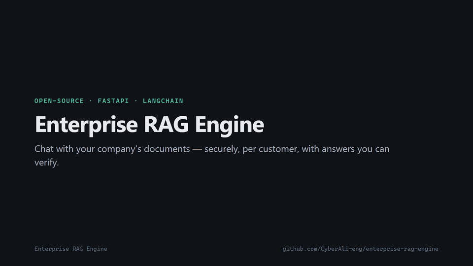
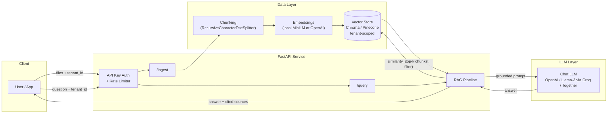

# Enterprise RAG Engine

Secure Retrieval-Augmented Generation service that connects unstructured corporate documents to LLMs — with per-tenant data isolation, pluggable vector stores and model providers, and no secrets ever committed to source control.


[](https://cyberali-eng.github.io/enterprise-rag-engine/#demo)

▶ **[Watch the 2-minute demo with voice-over](https://cyberali-eng.github.io/enterprise-rag-engine/#demo)** · [Project page & API docs](https://cyberali-eng.github.io/enterprise-rag-engine/)

## Why this exists

Most RAG tutorials wire an LLM straight to a vector store with no auth, no tenant boundaries, and API keys hardcoded in a script. This project is the opposite: a small, honest reference implementation of what "production-grade" actually requires —

- **Secure by default** — API-key auth, rate limiting, CORS allow-list, file-size/type validation on uploads, zero secrets in source control.
- **Multi-tenant** — every chunk is stamped with a `tenant_id`; retrieval is filtered so one customer's documents never leak into another's answers.
- **Provider-agnostic** — swap OpenAI ⇄ Llama-3 (via Groq/Together) ⇄ a **free local model via Ollama**, and Chroma ⇄ Pinecone, with one environment variable, no code changes.
- **Grounded answers** — the LLM is instructed to answer only from retrieved context and to cite sources; retrieved snippets are returned alongside every answer so claims are verifiable, not trusted blindly.
- **Actually tested** — a real pytest suite covers auth enforcement and chunking, run in CI on every push, alongside automated secret-scanning.

## Architecture



**Request flow:**
1. A client uploads documents to `POST /ingest` with a `tenant_id`. Files are validated (type, size), split into overlapping chunks, embedded, and upserted into the vector store with tenant metadata attached.
2. A client asks a question via `POST /query`. The question is embedded, the vector store returns the top-k chunks **filtered to that tenant only**, and those chunks are injected into a grounding prompt.
3. The LLM answers strictly from the provided context and is told to say so if the answer isn't in it — the response includes the source snippets it used, so the answer is auditable.

## Tech stack

| Layer | Choice | Why |
|---|---|---|
| API | FastAPI + Pydantic v2 | async, typed, auto-generated OpenAPI docs at `/docs` |
| Orchestration | LangChain | chunking, retriever, provider abstractions |
| LLM | OpenAI, Llama-3 (Groq/Together) *or* a local model via Ollama (all OpenAI-compatible) | swap via `LLM_PROVIDER` env var |
| Embeddings | sentence-transformers (local, free) *or* OpenAI | swap via `EMBEDDING_PROVIDER` |
| Vector store | Chroma (local/free-tier) *or* Pinecone (managed) | swap via `VECTOR_STORE` |
| Auth | API key header + in-memory rate limiter | good enough for a single-instance deployment |
| CI | GitHub Actions | pytest + TruffleHog secret scanning on every push |

## Run it free with a local model (Ollama)

No API keys and nothing leaves your machine. Needs Docker and about 2 GB of disk space for the model.

```bash
git clone https://github.com/CyberAli-eng/enterprise-rag-engine.git
cd enterprise-rag-engine
cp .env.example .env
# in .env set:
#   API_KEYS=<any secret you choose>
#   LLM_PROVIDER=ollama
#   LLM_MODEL=llama3.2:3b
#   OLLAMA_BASE_URL=http://ollama:11434/v1
docker compose --profile local up --build
```

The `local` profile starts Ollama and a one-shot `ollama-pull` service that downloads `OLLAMA_MODEL` (default `llama3.2:3b`) on first run. The API is on `http://localhost:8000` (docs at `/docs`). Then [ingest](#ingest-documents) and [ask](#ask-a-question) as below.

## Getting started locally

```bash
git clone https://github.com/CyberAli-eng/enterprise-rag-engine.git
cd enterprise-rag-engine
python -m venv venv && source venv/bin/activate
pip install -r requirements.txt

cp .env.example .env
# edit .env: set API_KEYS, and an LLM_PROVIDER + OPENAI_API_KEY (OpenAI, Groq or Together),
# or LLM_PROVIDER=ollama with a local Ollama running (no key needed)

uvicorn app.main:app --reload
```

Visit `http://localhost:8000/docs` for interactive API docs.

### Ingest documents

```bash
curl -X POST http://localhost:8000/ingest \
  -H "X-API-Key: <your key>" \
  -F "files=@sample_docs/policy.txt" \
  -F "tenant_id=acme-corp"
```

Or bulk-ingest a folder without going through HTTP:

```bash
python scripts/ingest_cli.py ./sample_docs --tenant-id acme-corp
```

### Ask a question

```bash
curl -X POST http://localhost:8000/query \
  -H "X-API-Key: <your key>" \
  -H "Content-Type: application/json" \
  -d '{"question": "What is the refund policy?", "tenant_id": "acme-corp"}'
```

### Run tests

```bash
pytest -v
```

## Running with Docker

```bash
docker compose up --build                  # hosted LLM (OpenAI / Groq / Together)
docker compose --profile local up --build  # free local LLM via Ollama
```

## Deployment (free-tier friendly)

**Render / Railway (recommended for a quick live demo):**
1. Push this repo to GitHub.
2. Create a new Web Service, connect the repo, set build command `pip install -r requirements.txt` and start command `uvicorn app.main:app --host 0.0.0.0 --port $PORT`.
3. Add the same variables from `.env.example` in the dashboard's environment settings (never in the repo).
4. Keep `VECTOR_STORE=chroma` and `EMBEDDING_PROVIDER=local` for a fully free deployment — no external vector DB or embedding cost.
5. For an always-warm demo, use `LLM_PROVIDER=groq` (free tier, Llama-3, very low latency).

**AWS free tier:** build the Docker image, push to ECR, run on an EC2 `t2.micro` or App Runner; attach an EBS volume if you want the Chroma index to persist across restarts, or switch `VECTOR_STORE=pinecone` for managed persistence instead.

Live demo: _add your deployed URL here once hosted_.

## Security notes

- No API key, database URL, or model credential is ever hardcoded — everything is read from environment variables via `app/config.py`.
- `.env` is git-ignored; only `.env.example` (placeholders) is committed.
- CI runs TruffleHog on every push to catch any credential that slips through review.
- Per-tenant metadata filtering prevents cross-tenant document leakage at the retrieval layer, not just at the application layer. Every search is scoped to exactly one tenant; a request without `tenant_id` uses the `default` tenant, never all tenants.
- **Trust boundary:** API keys are service-level, so any valid key may pass any `tenant_id`. That fits a trusted backend calling the engine on behalf of its users. Before exposing the API directly to end users, bind keys to tenants or put JWT auth in front (see Roadmap).

## Roadmap

- [ ] Swap in-memory rate limiting for Redis when running multiple instances
- [ ] Add JWT-based user auth in front of the API-key service layer
- [ ] Bind API keys to the tenants they may access
- [ ] Streaming responses (SSE) for the `/query` endpoint
- [ ] PDF/DOCX ingestion support alongside `.txt`/`.md`

## License

MIT
